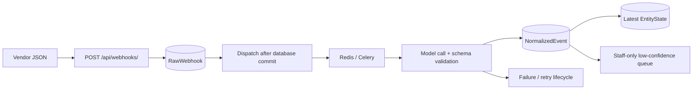

# Accept a webhook now; normalize it later

A Django/DRF and Celery prototype for turning varied shipment and invoice webhooks into a common event model. PostgreSQL stores accepted JSON, Redis carries asynchronous work, and a model-backed normalization service produces canonical events and a latest-state projection.

The useful engineering boundary is between durable acceptance and slower interpretation. A successful `202` means the raw record was accepted; it does not mean normalization succeeded or the model's interpretation is correct.

## Data flow



Idempotency prefers an external event ID and falls back to a deterministic payload hash, with database uniqueness constraints. The raw payload is stored as parsed JSON, not an exact byte-for-byte HTTP request. `transaction.on_commit` avoids starting a worker before the raw record commits, but there is no transactional outbox: a broker failure after commit can still require operator recovery.

The worker classifies `SHIPMENT`, `INVOICE`, or `UNCLASSIFIED`, validates allowed status values and timestamps, and records model/prompt metadata. The projection repository compares event times before updating the latest state. This is a useful prototype of event normalization, not an independently validated production event bus.

## Try synthetic webhooks locally

You need Docker/Compose and a configured model provider for real normalization. Use disposable development databases and the checked-in synthetic [samples](samples/).

```sh
cp .env.example .env
# Set a unique Django signing secret, database password, and provider configuration.
docker compose up --build
```

The Compose file publishes API, PostgreSQL, and Redis ports only on loopback. Startup applies migrations and collects static assets. The worker runs separately; database acceptance does not require the model to finish synchronously.

```sh
curl -X POST http://localhost:8000/api/webhooks/ \
  -H 'Content-Type: application/json' \
  -H 'X-Webhook-Vendor: Maersk' \
  -d @samples/maersk_shipment.json
```

A successful response contains `status: "accepted"` and `webhook_id`. Re-delivery should resolve through the idempotency key rather than create independent work. Source JSON is sent to the configured model provider during normalization; do not use real shipment, invoice, or personal data in this local demo.

## Operator access

Replay and operational read routes now require a Django staff account. Create one in the development stack with `docker compose exec web python manage.py createsuperuser`, then use its admin/session login or an authenticated development client. Session-authenticated writes require CSRF protection; do not disable that to make replay requests work.

| Route | Access and meaning |
| --- | --- |
| `GET /api/health/` | Public liveness response; not a full dependency readiness check |
| `POST /api/webhooks/` | Public prototype ingestion, with anonymous throttling |
| `POST /api/webhooks/<uuid>/replay/` | Staff only; optional `{"force": true}` requests replay of in-progress/received work |
| `GET /api/entities/state/?entity_type=SHIPMENT&entity_id=example` | Staff-only latest projection lookup |
| `GET /api/normalization/low-confidence/?threshold=0.7` | Staff-only review list, up to 100 events below a finite 0–1 threshold |
| `/api/docs/`, `/api/redoc/`, `/api/schema/` | Interactive schema/documentation |

The low-confidence endpoint is an inspection list, not a complete human approval workflow. Admin also exposes model records and replay actions. No repository UI or fabricated dashboard screenshot is needed to demonstrate this API's boundaries.

## Where to read the design

- [`apps/ingestion/services.py`](apps/ingestion/services.py): acceptance and commit-time dispatch.
- [`apps/ingestion/repositories.py`](apps/ingestion/repositories.py): uniqueness-backed raw storage.
- [`apps/normalization/tasks.py`](apps/normalization/tasks.py): worker status, retries, and failure handling.
- [`apps/normalization/schemas.py`](apps/normalization/schemas.py): permitted canonical output.
- [`apps/entities/repositories.py`](apps/entities/repositories.py): timestamp-based projection updates.

Structured JSON logs include correlation and processing identifiers. Prompt versions are persisted alongside normalized events. A schema-valid model response or confidence value does not prove factual correctness or protect against prompt injection in incoming payloads.

## Verification

The focused regression suite uses SQLite, an in-memory broker configuration, and no provider calls:

```sh
uv sync --frozen --no-dev --no-install-project
uv run --no-sync python manage.py test apps.ingestion --settings=config.test_settings
```

It checks anonymous/nonstaff denial, staff reads, unknown-resource responses, and invalid thresholds. PostgreSQL concurrency, Redis delivery, real model output, retry exhaustion, replay races, and Docker runtime were not exercised. These tests are not a throughput benchmark or proof of exactly-once delivery.

The lockfile is reconciled with the existing dependency declarations so the configured schema/documentation app can be imported after a frozen installation. No broad framework migration is part of this change.

## Before any shared deployment

Vendor signatures and sender authorization are not implemented; ingestion remains public and can trigger paid normalization work. Anonymous throttling is not a substitute for signature validation, authenticated senders, payload limits, or per-vendor quotas. Those controls, an outbox/recovery design, process-crash handling for records stuck in `PROCESSING`, and fault tests for retry exhaustion remain necessary work. Default development signing/database values must be replaced and allowed hosts restricted.

Obsolete publisher-artifact ignore entries were removed in the normal project update. They were text indicators without corroborating executable malware, not proof of infection.
